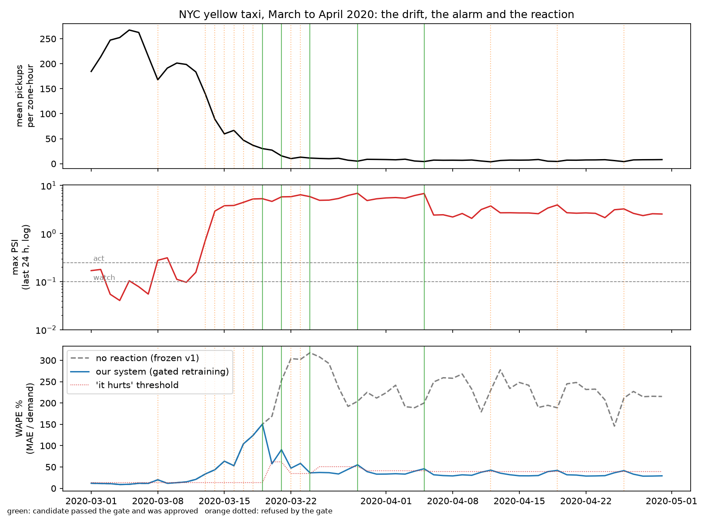
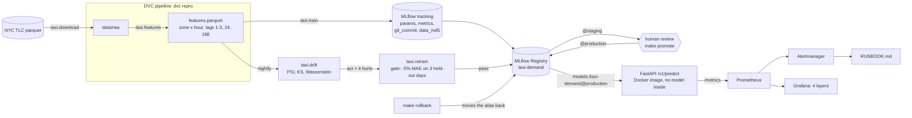

# taxi-demand-mlops

MLOps & Model Deployment, Albert School, group project. **Group 3, solo: Khaled Elnagar.**

The system forecasts **next-hour yellow-taxi pickups for one NYC zone** and keeps that forecast trustworthy in production. It is trained on January and February 2020. It is then put through March and April 2020, when COVID cut demand by 95%. The system notices the drift, checks whether it hurts, retrains behind a gate, waits for a human to approve, and can roll back in about a second.

* Story and numbers: [INCIDENT_REPORT.md](INCIDENT_REPORT.md)
* What to do when an alert fires: [RUNBOOK.md](RUNBOOK.md)


*(a copy of `reports/incident_timeline.png`, which `make simulate` regenerates)*

## The system on one diagram



## Fresh clone to working system

Needs [uv](https://docs.astral.sh/uv/) and Python 3.12. Docker is only needed for the monitoring stack and the image.

```bash
git clone <this repo> && cd taxi-demand-mlops
make all        # uv sync --locked, dvc repro (downloads 4 TLC months, ~200 MB), train, promote, simulate
```

That is enough to get the whole incident story in `reports/` and six model versions in the registry. Most of the time goes into the download.

Step by step:

| Command | What it does |
|---|---|
| `make setup` | `uv sync --locked` from the committed `uv.lock` |
| `make data` | `dvc repro`: download the TLC files, build zone x hour features. The DVC remote in `.dvc/config` is a folder on the author's laptop, so on another machine `dvc repro` rebuilds the data from the TLC source instead of `dvc pull` |
| `make train` | train on 1 Jan to 14 Feb, validate on 15 to 29 Feb (split by time, never at random), register as `@staging` |
| `make promote` | the human approval step: `@staging` to `@production` |
| `make status` | versions, aliases, validation MAE, reason, git commit |
| `make repro` | reproduction test: refit version 1 from code and data, compare with the logged metrics within 1e-6 |
| `make serve` | API on :8000, docs on `/docs`, metrics on `/metrics/` |
| `make simulate` | replay March and April 2020 one day at a time (drift check, hurt check, gated retraining, approval) |
| `make rollback` | `@production` back to the version it replaced, and reload the API |
| `make monitoring` | Prometheus :9090, Alertmanager :9093, Grafana :3000 (dashboard "Taxi demand API: four layers") |
| `make image` / `make docker-serve` | build the API image tagged with the commit, run it |
| `make test` / `make lint` | 13 tests (API contract, drift, registry round trip), ruff |
| `make reset` | forget every run and model version, keep the data |

Configuration: copy `.env.example` to `.env`. Nothing in it is secret. By default MLflow is a SQLite file next to the code, so no server is needed.

## The live demo (5 minutes)

```bash
make reset && make train && make promote     # v1, trained on normal traffic, in @production
make serve                                    # terminal 1
make monitoring                               # Grafana on http://localhost:3000
```

1. **A request.** Open `http://localhost:8000/docs` and run `POST /v1/predict`:
   ```json
   {"zone": 161, "ts": "2020-02-18T18:00:00", "lag_1": 300, "lag_2": 280, "lag_3": 250, "lag_24": 310, "lag_168": 305}
   ```
   Send a negative lag or an unknown field and you get a 422: the caller's fault, not ours.
2. **Normal traffic.** `make traffic PERIOD=normal`. Replays February. Input PSI stays around 0.02 to 0.06, "stable".
3. **The drift alert.** `make traffic PERIOD=covid`. Replays late March. PSI jumps to 5 to 7 on every lag. After 30 s, **InputDrift** and **PredictionDrift** fire in Alertmanager (`http://localhost:9093`).
4. **The reaction.** `make simulate` in a second terminal: the gate refused 7 candidates while the regime was moving, then approved v2 on 19 March (+58%), and v6 is in `@production` by April. `curl -X POST localhost:8000/v1/admin/reload` makes the API serve it.
5. **The rollback.** `make rollback`. `@production` moves back one version (v6 to v5) and the API reloads. Measured: 1.1 s. `curl localhost:8000/v1/model` shows the new version.

## What is where

```
taxi/download.py      TLC files for params.data.months
taxi/features.py      hourly counts per zone, complete grid, lags 1, 2, 3, 24, 168
taxi/model.py         fit, evaluate (MAE, RMSE, WAPE), log to MLflow, register, load by alias
taxi/train.py         first model, @staging
taxi/registry.py      promote, rollback (history kept in a registry tag), status
taxi/drift.py         PSI per feature against the reference saved with the model; KS and Wasserstein too
taxi/retrain.py       cooldown, candidate on the last 14 days, gate on the last 3
taxi/simulate.py      the incident replay
taxi/traffic.py       live traffic for the demo
taxi/repro_check.py   the reproduction test
app/main.py           FastAPI: /health, /v1/predict, /v1/model, /v1/admin/reload, /metrics
params.yaml           data, periods, model hyper-parameters
policy.yaml           drift and retraining thresholds (a change is a reviewed commit)
monitoring/           Prometheus scrape and alert rules, Alertmanager, Grafana dashboard
.github/workflows/    ci.yml (ruff, pytest, image build) and retrain.yml (manual, approved, one at a time)
```

## Design choices and trade-offs

* **Aliases, not stages, not paths.** The API loads `models:/taxi-demand@production`. Promotion and rollback move one alias, so they are instant and nothing is rebuilt. The cost: the registry must be reachable at start-up, and `/health` answers 503 until it is.
* **The reference distribution travels with the model.** Each run logs `reference.json` (deciles and a sample of the drift features), so drift is always measured against what *that* model was trained on.
* **Drift is not a reason to retrain. Harm is.** Retraining needs PSI over 0.25 *and* WAPE at least 1.2 times the deploy-time WAPE. We use WAPE, not MAE: when demand falls 20 times, the MAE falls with it and hides the damage.
* **The gate decides, a human approves.** A candidate must beat production by 5% MAE on 3 held-out days it never saw. Passing only puts it in `@staging`. This refused 12 of 17 candidates in the replay, and every refusal was right.
* **Simple model.** One `HistGradientBoostingRegressor` on lags. The project is about the system around it. The model is saved with skops, not pickle.
* **Known limitation:** after a promotion the PSI stays high, because the new reference still contains the transition. The hurt check stops it from causing retraining. A rolling reference is the fix (see the incident report).

## Data

NYC Taxi and Limousine Commission (TLC), *Yellow Taxi Trip Records*, January to April 2020. https://www.nyc.gov/site/tlc/about/tlc-trip-record-data.page. Raw files are not committed. `taxi/download.py` and the DVC pipeline reproduce them.

## Use of AI tools

AI tools are allowed in this course. I used Claude (Anthropic) through Claude Code as a pair programmer: scaffolding the code, writing tests and docs, and debugging (the skops trusted types, the switch from MAE to WAPE for the hurt check). I made the design choices, ran every experiment, and checked every number in this README and in the incident report against the generated reports.

## Solo group

Group 3 has one member, so the peer-review part of the grade does not apply.
