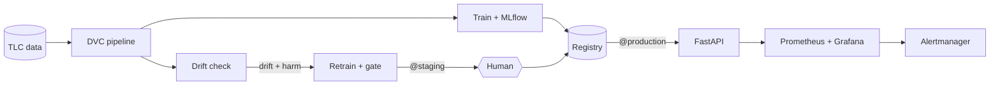

# Taxi Demand MLOps

Forecasts next-hour NYC yellow-taxi pickups per zone, and keeps the forecast right when the data changes.

The model is trained on Jan–Feb 2020, then replayed through the COVID collapse of Mar–Apr 2020. The system sees the drift, checks whether it hurts, retrains behind a gate, waits for a human, and can roll back in about a second.

Albert School · MLOps & Model Deployment · Group 3 (solo): Khaled Elnagar


---

## Results

Replay of 1 March to 30 April 2020 (`make simulate`).

| | No reaction | With the system |
|---|---|---|
| Average error (MAE, pickups) | 23.41 | **12.55** |
| Average error / demand (WAPE) | 171% | **38%** |
| First drift alarm | | 8 March, 11 days before the worst day |
| Retrains | | 17 started, 5 approved, 12 refused by the gate |
| Rollback | | 1.1 s, nothing rebuilt |

Day by day: [INCIDENT_REPORT.md](INCIDENT_REPORT.md). What to do when an alert fires: [RUNBOOK.md](RUNBOOK.md).

---

## Quickstart

Needs [uv](https://docs.astral.sh/uv/) and Python 3.12. Docker is only needed for monitoring.

```bash
git clone https://github.com/khaledngr/taxi-demand-mlops && cd taxi-demand-mlops
make all
```

`make all` installs the locked environment, downloads the TLC data, trains, promotes and replays the incident. The results land in `reports/`.

---

## How it works



| Step | What happens | Where |
|---|---|---|
| Data | Download 4 monthly TLC files, count pickups per zone and hour, add lags 1, 2, 3, 24, 168 h | `taxi/download.py`, `taxi/features.py`, `dvc.yaml` |
| Train | Gradient boosting, split by time. MLflow logs params, metrics, git commit and data hash | `taxi/model.py`, `taxi/train.py` |
| Release | The new version goes to `@staging`. A human moves it to `@production` | `taxi/registry.py` |
| Serve | FastAPI loads `models:/taxi-demand@production`, never a file path | `app/main.py` |
| Monitor | Prometheus metrics on four layers: latency, input PSI, prediction PSI, model version | `app/main.py`, `monitoring/` |
| Drift | PSI per feature against the reference saved with the model. KS and Wasserstein too | `taxi/drift.py` |
| Retrain | Only if PSI > 0.25 **and** WAPE ≥ 1.2 × the deploy-time WAPE. Cooldown 24 h | `taxi/retrain.py`, `policy.yaml` |
| Gate | The candidate must beat production by 5% MAE on the last 3 days it never saw | `taxi/retrain.py` |
| Rollback | Moves `@production` back one version, the API reloads | `taxi/registry.py` |

All thresholds are in [policy.yaml](policy.yaml), so changing one is a reviewed commit.

---

## Commands

| Command | Does |
|---|---|
| `make setup` | Install the locked environment |
| `make data` | Download and build features (`dvc repro`) |
| `make train` | Train on 1 Jan–14 Feb, validate on 15–29 Feb, register `@staging` |
| `make promote` | `@staging` → `@production` |
| `make status` | Versions, aliases, metrics, commits |
| `make serve` | API on `:8000`. Docs on `/docs`, metrics on `/metrics/` |
| `make monitoring` | Prometheus `:9090`, Alertmanager `:9093`, Grafana `:3000` |
| `make traffic PERIOD=normal` | Send February traffic to the API |
| `make traffic PERIOD=covid` | Send late-March traffic to the API |
| `make simulate` | Replay March–April 2020, one day at a time |
| `make rollback` | `@production` → previous version |
| `make repro` | Retrain v1 from code and data, compare with MLflow |
| `make image` | Build the API image, tagged with the commit |
| `make test` · `make lint` | 15 tests · ruff |
| `make reset` | Delete runs, models and reports. Keeps the data |

---

## API

| Endpoint | Returns |
|---|---|
| `POST /v1/predict` | Forecast and model version. 422 on bad input, 503 with no model |
| `GET /health` | 200 with the model version, 503 with no model |
| `GET /v1/model` | Alias, version, features |
| `POST /v1/admin/reload` | Reload the alias after a promotion or rollback |
| `GET /metrics/` | Prometheus metrics |

```bash
curl -X POST localhost:8000/v1/predict -H 'content-type: application/json' \
  -d '{"zone":161,"ts":"2020-02-18T18:00:00","lag_1":300,"lag_2":280,"lag_3":250,"lag_24":310,"lag_168":305}'
```

---

## Demo

```bash
make reset train promote     # v1 in production
make serve                   # terminal 1
make monitoring              # Grafana at localhost:3000
```

1. **Request:** `POST /v1/predict` at `localhost:8000/docs`. A negative lag returns 422.
2. **Normal traffic:** `make traffic PERIOD=normal`. PSI stays near 0.
3. **Drift:** `make traffic PERIOD=covid`. PSI goes above 7 and InputDrift fires.
4. **React:** `make simulate`. The gate refuses 7 candidates, then approves v2 on 19 March.
5. **Roll back:** `make rollback`. The API serves the previous version about a second later.

---

## Repository

```
taxi/          pipeline: download, features, model, train, registry, drift, retrain, simulate
app/           FastAPI service
tests/         API contract, drift, harm rule, promote and rollback
monitoring/    Prometheus rules, Alertmanager, Grafana dashboard
.github/       CI (lint, tests, image) and a manual retrain workflow
docs/          incident figure and summary
params.yaml    data, periods, model settings
policy.yaml    drift and retraining thresholds
```

---

## Known limits

- **PSI stays high after a promotion**, because the new model's reference still contains the transition. The harm check stops useless retrains. The fix is a rolling reference.
- **The DVC remote is a local folder**, so on another machine `make data` downloads from the TLC again.
- **MLflow is a local SQLite file.** A shared server would let the retrain workflow run in CI.

---

## Notes

- **Data:** NYC TLC Yellow Taxi Trip Records, Jan–Apr 2020, [nyc.gov/tlc](https://www.nyc.gov/site/tlc/about/tlc-trip-record-data.page). Raw files are not committed.
- **Config:** copy `.env.example` to `.env`. Set `TAXI_ADMIN_TOKEN` anywhere outside a laptop.
- **AI use:** Claude (via Claude Code) was used as a pair programmer for code, tests, docs and debugging. Design choices, experiments and numbers were checked by me.
- **Solo group:** peer review does not apply.
