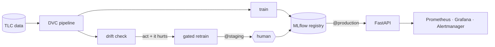

# Taxi Demand MLOps

Forecast next-hour NYC yellow-taxi pickups per zone, and keep the forecast trustworthy when the world changes.

Trained on Jan–Feb 2020, then replayed through the COVID collapse of Mar–Apr 2020: the system **detects** the drift, **checks** whether it hurts, **retrains** behind a gate, **waits** for a human, and **rolls back** in about a second.

Albert School · MLOps & Model Deployment · Group 3 (solo): Khaled Elnagar

| | |
|---|---|
| [INCIDENT_REPORT.md](INCIDENT_REPORT.md) | what happened in March 2020, day by day |
| [RUNBOOK.md](RUNBOOK.md) | what to do when an alert fires |


---

## Results

| | no reaction | this system |
|---|---|---|
| Mean MAE (pickups) | 23.41 | **12.55** |
| Mean WAPE | 171% | **38%** |
| First alarm | | 8 Mar, 11 days before the worst day |
| Retrainings | | 17 started · 5 approved · 12 refused by the gate |
| Rollback | | 1.1 s, nothing rebuilt |

---

## Architecture



| Layer | Tool |
|---|---|
| Data | DVC pipeline: download → zone × hour features |
| Tracking | MLflow: params, metrics, `git_commit`, `data_md5` |
| Registry | MLflow aliases `@staging`, `@production` |
| Serving | FastAPI, Docker image with no model inside |
| Monitoring | Prometheus, Grafana, Alertmanager, four layers |
| Drift | PSI, KS and Wasserstein, against the reference saved with each model |
| Retraining | gate: −5% MAE on 3 held-out days, then human approval |
| CI | GitHub Actions: lint, tests, image build, manual retrain |

---

## Quickstart

Needs [uv](https://docs.astral.sh/uv/). Docker is only needed for monitoring.

```bash
make all
```

This runs setup, data, train, promote and simulate: a fresh clone to the full incident story.

| Command | Does |
|---|---|
| `make setup` | install the locked environment |
| `make data` | download TLC files, build features (`dvc repro`) |
| `make train` | train on Jan–mid Feb, register `@staging` |
| `make promote` | human approval: `@staging` → `@production` |
| `make serve` | API on `:8000` (`/docs`, `/metrics/`) |
| `make monitoring` | Prometheus `:9090`, Alertmanager `:9093`, Grafana `:3000` |
| `make simulate` | replay Mar–Apr 2020 |
| `make rollback` | `@production` → previous version |
| `make status` | versions, aliases, metrics, commits |
| `make repro` | refit v1, compare with logged metrics (1e-6) |
| `make test` · `make lint` | 13 tests · ruff |

---

## Demo

```bash
make reset train promote     # v1 in production
make serve                   # terminal 1
make monitoring              # Grafana at localhost:3000
```

1. **Request:** `POST /v1/predict` at `localhost:8000/docs`. A bad input returns 422.
2. **Normal traffic:** `make traffic PERIOD=normal`. PSI around 0.05, stable.
3. **Drift:** `make traffic PERIOD=covid`. PSI 5–7, then InputDrift fires.
4. **React:** `make simulate`. The gate refuses 7 candidates, then approves v2.
5. **Roll back:** `make rollback`. The API serves the previous version in 1.1 s.

---

## Design choices

- **Aliases, not paths.** The API loads `models:/taxi-demand@production`, so promotion and rollback only move a pointer.
- **Drift ≠ retrain.** Retraining needs PSI > 0.25 **and** WAPE ≥ 1.2 × the deploy-time WAPE. WAPE, because MAE falls along with demand.
- **The gate decides, a human approves.** Passing only reaches `@staging`.
- **The reference travels with the model**, so drift is measured against what that model learned.
- **Simple model** (gradient boosting on lags). The project is the system around it.
- **Known limit:** the PSI stays high after a promotion. The fix is a rolling reference.

---

## Repository

```
taxi/        pipeline: download, features, model, train, registry, drift, retrain, simulate
app/         FastAPI service
tests/       API contract, drift, registry round trip
monitoring/  Prometheus rules, Alertmanager, Grafana dashboard
docs/        incident figure and summary
params.yaml  data, periods, hyper-parameters
policy.yaml  drift and retraining thresholds
```

---

## Notes

- **Data:** NYC TLC Yellow Taxi Trip Records, Jan–Apr 2020, [nyc.gov/tlc](https://www.nyc.gov/site/tlc/about/tlc-trip-record-data.page). Raw files are not committed; DVC rebuilds them.
- **Config:** copy `.env.example` to `.env`. No secrets are needed.
- **AI use:** Claude (via Claude Code) was used as a pair programmer for code, tests, docs and debugging. Design choices, experiments and numbers were checked by me.
- **Solo group:** peer review does not apply.
